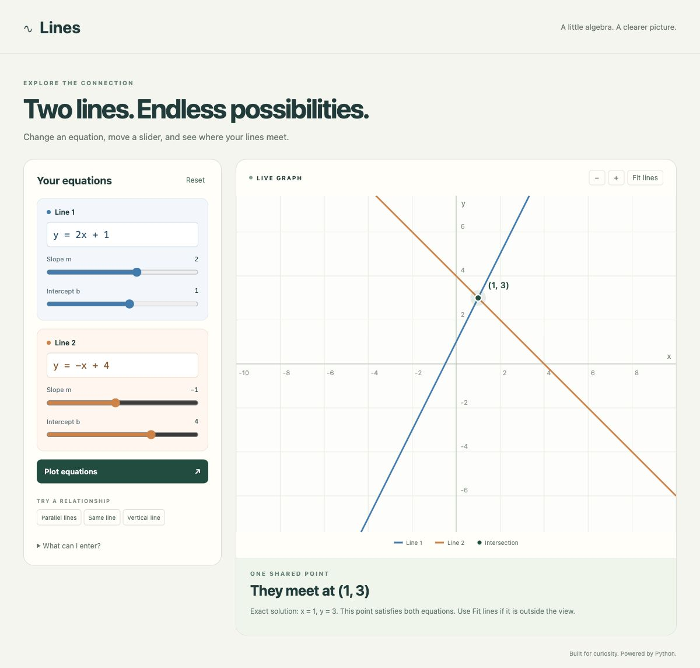

# Lines · Graph calculator

A Python-powered interactive calculator for comparing two straight lines. Enter
equations, move sliders, and see their intersection or learn why they never meet.



## Run locally

Requires **Python 3.10 or newer** and a modern browser. No third-party packages,
API keys, build tools, or internet connection are needed to run the app.

```sh
python3 app.py
```

Open **http://127.0.0.1:8000** in your browser. Keep the terminal running; press
Ctrl+C to stop. To use a different port, run `python3 app.py --port 8080`.
The server listens on your own computer only.

## Explore

- Enter `y = 2x + 1` and `y = -x + 4`. The graph marks **(1, 3)**.
- Adjust **Slope m** and **Intercept b** to change a nonvertical line.
- Enter `x = 3` to get a vertical line with a horizontal-position slider.
- Use the example buttons for parallel lines, identical lines, and a vertical line.
- Zoom in or out, or choose **Fit lines** to include both lines' intercepts and
  their intersection. Reset restores the starting equations and view.
- Coordinates are also shown below the graph, including exact fractions.

## Equation formats

Both sides can contain linear expressions. Supported examples:

| Format | Example |
| --- | --- |
| Slope-intercept | `y = 2x + 1` |
| Vertical / horizontal | `x = 3`, `y = -2` |
| Standard form | `2x + 3y = 6` |
| Fractions / decimals | `y = x/3 + 0.5` |
| Parentheses | `2(x + y) = 6` |
| Scientific notation | `y = 1e-2 * x` |

Use lowercase `x` and `y`, one equals sign, and `+`, `-`, `*`, `/`, or
parentheses. Implicit multiplication such as `2x` is supported. Curves, powers,
functions, products of variables, and division by a variable are rejected with
an explanation. Equations such as `1 = 1` do not define a single line.

Each equation is limited to 200 characters. Intermediate rational values must
have magnitude at most 1e12 and denominator at most 1e12; scientific exponents
must be between -12 and 12. Sliders edit decimal approximations of a line's
slope/intercept; type a fractional equation to preserve an exact rational input.
Graph labels use rounded values, while the solution text includes exact fractions.

## How it works

- `lines.py` parses a restricted Python expression tree without executing input.
  It represents lines as **Ax + By = C**, including vertical lines. Fractions
  preserve exact input arithmetic and avoid rounding-based parallel tests.
- `app.py` serves the page and a local `POST /api/compare` endpoint.
- `static/` contains the responsive browser interface and SVG graph. Inputs have
  labels and field errors; sliders work with a keyboard; results have live text
  announcements. Identical lines use an overlapping dashed stroke.

## Check the calculations and server

```sh
python3 -m unittest discover -s tests -v
```

The tests cover intersections, vertical and horizontal lines, parallel and
identical lines, exact fractions, nearly parallel lines, invalid input, and HTTP
responses. GitHub Actions runs these checks on Python 3.10, 3.12, and 3.13.
